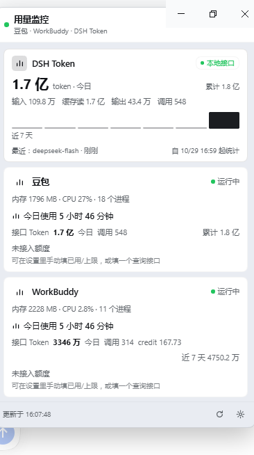

# 用量监控 / Usage Watch

Harness Web UI 插件：**左侧栏入口 + 可拖动、可置顶的悬浮窗**，监视 **豆包 / WorkBuddy / DSH Token** 的使用情况。



已经打包成标准 DSH bundle：`package.json` 同时声明 `dsh.bundle`（Host 补丁）与 `dsh.client`（浏览器侧模块），
发布到 npm 后一条命令即可安装：`dsh plugin add dsh-usage-watch`。

## 它显示什么（数据口径）

| 指标 | 来源 | 真实性 |
|---|---|---|
| DSH Token 今日 / 累计 / 近 7 天柱图 | 优先读本地 token 接口（`127.0.0.1:8765`），不可用时回退 Host 的 `llm/stream` 统计 | ✅ 真实；从插件启用开始累计 |
| 豆包 / WorkBuddy 是否运行、进程数 | `Get-Process` 进程探测（30s） | ✅ 真实（Windows） |
| 内存 / CPU / 已运行时长 | 进程工作集 + 两次采样差值 | ✅ 真实 |
| 豆包 / WorkBuddy 今日使用时长 | 进程在运行的时间按日累计（30s 采样，上限单次 120s） | ✅ 真实；插件启用后开始累计 |
| 豆包 Token（接口） | 豆包提供的 8765 接口 `today.totalTokens`（`services.doubao.tokenEndpoint`） | ✅ 接口真实值；接口掉线时回退本机统计并明确标注 |
| WorkBuddy Token（接口） | WorkBuddy 本机 metrics 接口 `http://127.0.0.1:8787/api/metrics?days=7`（`services.workbuddy.tokenEndpoint`）：今日 totalTokens / 调用次数 / credit，及窗口累计「近 7 天」 | ✅ 接口真实值；接口掉线时保留上次真实数字并明确标注 |
| 豆包 / WorkBuddy 额度 | 你配置的 HTTP 接口，或手动录入的已用/上限 | ⚠️ 未配置时显示「未接入额度」，**不编造数字** |

**豆包 / WorkBuddy 卡片显示什么**：豆包卡片把豆包提供的 8765 接口作为「Token 用量接口」接入
（`services.doubao.tokenEndpoint`），显示接口返回的今日 token / 调用次数；WorkBuddy 卡片接入它自己的
`8787 /api/metrics?days=7`，显示今日 token / 调用次数 / credit 与近 7 天累计。两个接口掉线时都不会让数字消失：
- 和 DSH Token 同一个接口（豆包默认的 8765）→ 回退本机 `llm/stream` 统计，并标「接口未连接 · 显示本机统计」；
- 不同源接口（WorkBuddy 的 8787）→ 保留上次拉到的真实数字，标「接口暂不可用 · 显示上次数据」，重连后自动更新。
**额度**仍需要你填应用自己的接口或手动值（客户端不提供额度数据）；DSH Token 卡片则使用本机 `llm/stream` 统计与同一个 8765 接口（两处同源，数值一致）。

DSH Token 的口径是 **provider 回报的 usage**（`inputTokens` / `cacheReadTokens` / `outputTokens` / `totalTokens`），
卡片同时显示「今日总量」和 输入 / 缓存读 / 输出 / 调用次数。一次模型调用只在流结束时结算**最后一个** usage chunk，
同一调用里的多个 usage（重试 / 分段）不会重复累加。卡片右上角的来源标签会显示 **本地接口**（接口可用）
或 **本机统计**（接口不可用，卡片里会附错误原因）——两者数值同源，接口只是本地 HTTP 包装。

## 界面与交互

1. **左侧栏图标「用量监控」**（`sidebar.panellist`，order 20）→ 打开主面板里的完整看板：
   三张卡片 + 近 7 天柱图 + 设置 + 悬浮窗开关。
2. **左侧栏底部按钮**（`sidebar.footer.action`，设置按钮旁）→ 直接开关悬浮窗，不离开当前对话。
3. **悬浮窗**（`shell.overlay`）：
   - 拖动**标题栏**移动窗口：窗口被完整限制在应用窗口内（四边至少留 8px），拖不出边界；
     双击标题栏复位到默认位置；收起 / 展开设置 / 浏览器窗口缩放时自动重新夹紧；
   - 右上角 **📌 置顶**：置顶时悬浮层 z-index 最高（在设置面板、对话框之上），阴影加重；
   - **收起**（只留标题栏）/ **关闭**；
   - 位置、置顶、收起状态保存在浏览器 `localStorage`，刷新页面后恢复。
4. 悬浮窗里的 **齿轮**：「设置」——
   - 每个服务：额度接口 URL、**Token 用量接口 URL**、token（已保存时留空不改）、手动已用 / 上限 / 单位；
   - DSH Token：每日预算（0 = 不设）、**接口 URL**（默认 `http://127.0.0.1:8765/api/v1/token/usage`，留空 = 只用本机统计）；
   - 进程/额度刷新间隔；
   - 保存写进 `state.json`，立即生效。

## 安装与配置

### 从 npm 安装（推荐）

```sh
dsh plugin add dsh-usage-watch
# 或显式指定 profile：
dsh plugin --profile desktop add dsh-usage-watch
```

### 从源码目录安装

```powershell
# 在 Harness 对话里用内置工具：
plugin_manager install_bundle target=D:\DSH-Workspace\dsh-usage-watch
```

> 从旧的本地版本升级时，先把旧 bundle 停用/卸载（两个 bundle 会插入同一个 `usage-watch` Host 行，
> 同时启用会冲突）。

### 环境要求

- DSH `>= 0.2.0`（`engines.dsh`），Web UI / 桌面端均可（`dsh.client.platform = "web"`）；
- 进程 / 使用时长探测依赖 Windows 的 `Get-Process`；非 Windows 会显示「进程探测失败」而不是假状态；
- 插件本身零运行时依赖（Host 只用 Node 内置模块，客户端通过 loader 使用 React）。

### 配置

bundle 补丁 `cordis.patch.yml` 只做一件事：插入 Host 行。

```yaml
- insert:
    - id: usage-watch
      name: 'dsh-usage-watch'
      config:
        refreshSeconds: 30      # Host 探测 进程/额度 的间隔（浏览器每 5s 拉缓存状态）
        historyDays: 14
        dshtoken:
          dailyLimit: 0         # >0 时显示今日预算进度条
          apiEndpoint: 'http://127.0.0.1:8765/api/v1/token/usage'  # 留空 = 只用本机统计
        services:
          doubao:
            label: 豆包
            processes: [Doubao]
          workbuddy:
            label: WorkBuddy
            processes: [WorkBuddy, workbuddy]
```

配置优先级：`cordis.patch.yml` < 插件「设置」页写入的 `state.json`（用户改完不会被 patch 覆盖）。

### 额度接口约定（可选）

在「设置」里填了 URL 才启用；Host 每 `refreshSeconds` 发一次 `GET`：

```jsonc
// GET https://example.com/usage  （返回 200 + JSON）
{ "used": 120, "limit": 500, "unit": "次", "resetAt": "2026-11-01", "note": "月度额度" }
```

- 默认按 `used` / `limit` 取数，字段名不同可用 `fields` 指定路径（如 `data.consumed`）；
- token 非空时放 `Authorization: Bearer <token>`（可用 `tokenHeader` 改头名）；
- 接口失败时：优先退回你填的手动值，否则保留上一次成功的数据，并在卡片上显示错误原因。

## 本地 Token 接口（豆包给的 8765 接口）

`D:\DSH-Workspace\token-usage-api` 是一个独立的只读 HTTP 服务，读的就是本插件写出的
`state.json`，所以接口数字和悬浮窗一致。插件的 DSH Token 卡片默认会调用它（见上面的 `apiEndpoint`）。

**不想敲命令**：直接双击 `D:\DSH-Workspace\token-usage-api\查看用量.cmd`，
会打印今日 / 累计 / 输入·缓存读·输出 / 最近一次调用；接口没启动时它会自动帮你启动。

命令行方式（等价）：

```powershell
(Invoke-RestMethod 'http://127.0.0.1:8765/api/v1/token/usage').today.totalTokens
```

启动 / 停止接口：

```powershell
powershell -ExecutionPolicy Bypass -File D:\DSH-Workspace\token-usage-api\start-api.ps1
powershell -ExecutionPolicy Bypass -File D:\DSH-Workspace\token-usage-api\stop-api.ps1
```

接口不可用时插件不会报错：卡片退回「本机统计」并显示接口错误。默认还会在接口掉线时自动用
`start-api.ps1` 把本地 token 服务拉起一次（2 分钟内最多一次，可在设置里关掉这个自动拉起开关）。

## 文件

```
dsh-usage-watch/
  package.json        npm 元数据 + dsh.bundle / dsh.client 声明（发布入口）
  index.js            Host 入口：llm/stream 监听、引擎启动、3 条路由、卸载清理
  lib/config.js       配置归一化（默认值 / 额度字段 / 脱敏的 publicConfig）
  lib/tracker.js      DSH Token 累计（按日 / 累计 / 7 天历史 / 反序列化）
  lib/probe.js        Windows 进程探测（PowerShell Get-Process + CPU 差值聚合）
  lib/quota.js        额度接口请求与 JSON 解析、手动值、百分比
  lib/engine.js       引擎：定时刷新、额度降级、持久化、State 组装、设置校验、token 服务自动拉起
  lib/routes.js       /api/usage-watch/{state,refresh,config}
  client.js           浏览器侧（手写 React，无构建）：左侧栏入口 / 看板 / 悬浮窗
  locale/zh.json      插件管理页显示名（用量监控）
  locale/en.json      Plugin Manager display metadata
  icon.svg            插件图标（原创）
  cordis.patch.yml    bundle 补丁（插入 usage-watch 行）
  test/*              离线自检 + Host 集成自检 + 渲染自检
  docs/screenshot.png 悬浮窗实拍
  docs/market-entry.yml  插件市场上架条目（提交到 awesome-dsh-plugin）
  docs/PUBLISH.md     发布步骤（npm + GitHub + 市场 PR）
  LICENSE, .gitignore
```

状态文件：`%USERPROFILE%\.dsh\usage-watch\state.json`

```jsonc
{
  "version": 1,
  "updatedAt": 1793...,
  "config": {},                  // 设置页写入的部分
  "tokens": { "days": {}, "allTime": {}, "lastCall": null, "trackingSince": ... },
  "diagnostics": { "probeSupported": true, "services": [{ "id": "doubao", "running": true }] }
}
```

`diagnostics` 记录最后一次进程探测 / 额度结果，出问题时可以直接看这个文件。

## 验证

在插件目录下用 Harness 自带的 Node：

```powershell
$node = 'C:\Users\ASUS\.dsh\dsh-runtimes\dsh-primary-runtime\dependencies\node\bin\node.exe'
& $node test\smoke.mjs              # 23 项：配置归一化 / token 累计 / 进程解析 / 聚合 / 额度解析 / 设置校验 / URL 归一化 / tokenService 默认值
& $node test\host-integration.mjs   # 10 项：引擎 + 路由 + llm/stream + 持久化 + 额度降级 + token 接口 + 使用时长 + 服务 token 接口 + 8787 metrics 映射 + 自动拉起
& $node test\check-client.cjs       # Client：4 个 slot 注册、zh/en 字典、真实 State 渲染（卡片/额度条/柱图/接口来源/回退态/使用时长/接口 Token）
```

实时验证：

- `plugin_manager install_bundle` → `application: applied`，`warnings: []`；
- `cordis_inspect_query Slots.listSubTree` 四个占用项均 `active: true`：
  `shell.overlay`（id `usage-watch`, order 60）、`sidebar.panellist`（order 20）、
  `sidebar.footer.action`（order 10）、`main`（key `usage-watch`）；
- `%USERPROFILE%\.dsh\usage-watch\state.json` 出现真实累计（见下方）；
- 进程探测（豆包）：见「实测」一节。

### 实测

- **Host fiber active**：`plugin_manager list_plugins` → `include:usage-watch`
  `enabled: true`，`fiberPhase: active`，无 warning；
- **DSH Token 真实累计**（`%USERPROFILE%\.dsh\usage-watch\state.json`）：
  跨两天持续累计（2026-10-30 10:00 时今日 9,232 万 tokens / 237 次调用，其中 cacheRead 9,100 万）；
  其中绝大部分是 `cacheReadTokens`——DeepSeek 的 context 缓存命中，属于 provider 真实口径；
- **本地 token 接口已接入**：`diagnostics.tokenApi = { endpoint: "http://127.0.0.1:8765/api/v1/token/usage", ok: true }`，
  卡片优先显示接口值；接口停掉时自动回退「本机统计」并显示错误；
- **双击脚本可用**：`token-usage-api\查看用量.cmd` → 今日 9,133 万 tokens / 234 次调用（2026-10-30 10:00 实测），
  接口未启动时会自动拉起；
- **使用时长真实累计**（2026-10-30 10:18 实测）：重新激活插件后约 70s，
  `activeTime.days['2026-10-30'] = { doubao: 59.8, workbuddy: 59.8 }`，
  卡片显示「今日使用 1 分钟」并按 30s 采样继续增长；进程退出后当前连续时长归零、当日累计保留；
- **豆包 card 的 token 接口已生效**（2026-10-30 10:56）：`diagnostics.services.doubao.tokenUsageOk = true`，
  接口返回 `today.totalTokens = 111,939,605` / 288 次调用，卡片显示「接口 Token」一行；WorkBuddy 无 token 接口，该项为 null。
- **进程探测真实生效**（`diagnostics`，2026-10-30 09:11 采样）：
  `doubao: running=true, processCount=12, memoryMB=868.7`；
  `workbuddy: running=true, processCount=10, memoryMB=2176.4`；
- **热重载验证**：修改 Host 代码后 `set_plugin(disable → enable)`，`application: applied`，
  新代码生效（`diagnostics` 字段出现，探测结果如上），插件卸载/重启路径无残留错误。
- **未验证**：浏览器里的像素级呈现与拖动/置顶交互。当前环境看不到可见窗口
  （`Get-Process` 的 `MainWindowTitle` 全空），slot 注册成功只证明客户端模块已加载并执行。
  请在 Harness 页面上刷新一次（拿到最新 `client.js`），点左侧栏「用量监控」图标确认看板，
  再点底部按钮打开悬浮窗试用拖动 / 置顶。

## 已知限制

- 插件启用前的 DSH 用量不回填（不做会话日志重扫，避免拖慢启动）；如需从「今天 0 点」起算，可后续加回填。
- 进程探测只在 Windows 生效；Host 无法 `spawn powershell` 的受限环境会显示「进程探测失败」而不是假状态。
- 额度只有你提供了接口或手动值才显示；插件不猜、不模拟。
- 额度接口必须是返回 `used` / `limit` 的 JSON。DSH Token 的 8765 接口
  （`/api/v1/token/usage`、`/health`）不是额度接口，误填到豆包/WorkBuddy 的额度栏时，
  卡片会明确提示「这是 DSH Token 的用量接口 / 健康检查地址」，不会被当成额度数字。
- 本地 8765 接口是独立进程（`token-usage-api`），DSH 重启后它不会自动跟着启动；插件会自动回退本机统计，
  需要接口时运行 `start-api.ps1`，或在设置里打开「接口掉线时自动拉起本地 token 服务」并把启动脚本路径
  指向你自己的 `start-api.ps1`（该路径默认留空，因为不同机器位置不同；只对 `127.0.0.1` 端点生效，2 分钟冷却）。
- 修改 Host 侧代码后需要重新激活插件（`set_plugin` 关→开，立即生效）或重启 DSH；修改 `client.js` 后刷新页面即可。

## 变更记录

**2026-10-30 11:12 悬浮窗拖动范围收紧**

- 拖动时按窗口**实际宽高**计算边界，整个浮窗（含卡片内容）始终留在应用窗口内，四边至少 8px，
  不能再拖到只剩一条边或让下半截跑出窗口；
- 展开设置、收起、内容变高、浏览器窗口缩放时都会自动重新夹紧位置；
- 双击标题栏可以把浮窗复位到默认位置（右下角）。

**2026-10-30 15:45 接入 WorkBuddy 的 8787 metrics 接口 + 接口掉线不再丢数字**

- WorkBuddy 卡片新增「接口 Token」：`http://127.0.0.1:8787/api/metrics?days=7` 的今日 `totalTokens` / `requests` /
  `credit`，右侧显示窗口累计「近 7 天 N」；设置页可改这个 URL 或清空（清空 = 不显示接口 token）。
- 解析器同时支持两种真实接口格式：`{today, allTime}`（8765 token 接口）与
  `{usage:{window, totals, windowTotals, daily[]}}`（8787 metrics，`promptTokens`/`completionTokens`/`credit`）。
- 接口掉线不再让数字整行消失：
  - 8765（与 DSH Token 同源）→ 回退本机统计，标「接口未连接 · 显示本机统计」；
  - 8787（WorkBuddy 自己的间歇性服务）→ 保留上次真实数字，标「接口暂不可用 · 显示上次数据」。
- 新增 `tokenService` 配置（默认开启）：8765 接口不通时，插件用 `token-usage-api/start-api.ps1` 自动拉起本地
  token 服务（2 分钟内最多一次，只对 `127.0.0.1` 端点生效）；设置页有「接口掉线时自动拉起本地 token 服务」开关。
- `diagnostics` 新增 `tokenApi.source`（api/local）与 `tokenService`（autoStart / startScript / attemptedAt / started / error）。
- 运维：8787 由 WorkBuddy 自己生成的小服务（`D:\WorkBuddy\<会话>\wb-monitor\server.py`）监听，它退出后接口就不可用；
  面板会保留上次数字并提示，重连后自动恢复。

**2026-10-30 10:56 把豆包提供的 token 用量接口写入豆包卡片**

- 新增每服务可选的 `tokenEndpoint`（默认给豆包填 `http://127.0.0.1:8765/api/v1/token/usage`），
  豆包卡片显示「接口 Token：今日 totalTokens · 调用次数 · 累计」；接口失败只提示，不显示假数字；
- 设置页每个服务新增「Token 用量接口 URL」输入框；
- 注意：该接口的原始数据由本插件写出的 `state.json` 提供，所以豆包卡片与 DSH Token 卡片同源、数值一致；
  只想要一处显示时，把豆包「Token 用量接口」清空即可。

**2026-10-30 10:40 修复「额度接口失败」**

- 原因：豆包的「额度接口」被填成了 `http://127.0.0.1:8765/health`（DSH Token 服务的健康检查），
  返回 JSON 里没有 `used/limit`，卡片显示红色「额度获取失败」；已清空该配置；
- 现在误填 token 接口 / health 地址时，提示语会直接说明「这是 DSH Token 的用量接口，不是额度接口」；
- 额度接口输入框标签改为「返回含 used / limit 的 JSON」，减少误填。

**2026-10-30 10:18 豆包 / WorkBuddy 卡片增加「今日使用时长」**

- 引擎按探测采样累计每个桌面应用「真的在运行」的时长（按日、跨重启持久化，存 `state.json.activeTime`）；
- 卡片新增「今日使用 X 小时 Y 分钟」，进程退出后当前连续时长归零、当日累计保留；
- 额度接口 URL 支持不带 `http://`（自动补齐），避免「Failed to parse URL」这类错误；
- 说明：豆包客户端没有本地 token/额度接口，额度只能手动填或自备查询接口，插件不会编造数字。

**2026-10-30 接入豆包给的本地 token 接口**

- DSH Token 卡片优先显示 `http://127.0.0.1:8765/api/v1/token/usage` 的 `today` / `allTime` / `lastCall`，
  失败自动回退本机 `llm/stream` 统计；右上角标签显示「本地接口 / 本机统计」，失败时附错误原因；
- 设置页新增「DSH Token 接口 URL」，默认已填好，可清空改为纯本机统计；
- `state.json` 的 `diagnostics.tokenApi` 记录接口最近一次调用结果；
- 新增 `token-usage-api\查看用量.cmd`：双击即可看今日/累计用量，接口没启动时自动启动。

**2026-10-29 首次交付**

- 新增左侧栏图标入口 + 完整看板、左侧栏底部悬浮窗开关；
- 悬浮窗支持拖动标题栏、置顶、收起、关闭，状态持久化到 localStorage；
- DSH Token 监听 `llm/stream` 真实 usage，按日累计 + 7 天柱图 + 每日预算；
- 豆包 / WorkBuddy 进程状态真实采集，额度可选接口 / 手动；
- 3 条 Host 路由（state / refresh / config），token 脱敏后不下发浏览器。

## 发布

- npm：`npm publish`（`package.json` 已带 `publishConfig.access = "public"`，包名 `dsh-usage-watch`）；
- GitHub：`git push` 到 `https://github.com/AnnaAlexyevna/dsh-usage-watch`，给仓库加 topic `dsh-plugin`；
- 插件市场：向 [awesome-dsh-plugin](https://github.com/awesome-dsh-plugin/awesome-dsh-plugin) 提 PR，
  新增 `data/plugins/AnnaAlexyevna__dsh-usage-watch.yml`（模板见 `docs/market-entry.yml`，category 用 `usage`）。

完整命令、校验项与注意事项见 [docs/PUBLISH.md](docs/PUBLISH.md)。

## 相关

- 插件市场索引：<https://awesome-dsh-plugin.com/>
- 本机若另有 `token-usage-api` 只读服务（读的就是本插件的 `state.json`），DSH Token 卡片会优先用它的数字；
  没有也不影响使用，插件会回退到本机 `llm/stream` 统计。

## License

MIT © 2026 AnnaAlexyevna
